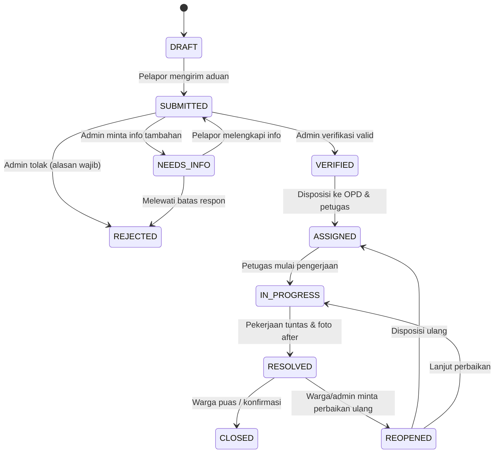

# Smart Complaint System (SCS) - Kota Bandar Lampung
### Sistem Pengaduan Masyarakat Berbasis Smart City

Aplikasi web pengaduan masyarakat terintegrasi yang dibangun berdasarkan **Product Requirements Document (PRD) v1.0 (10 November 2026)**.

---

## 🏛️ Identitas Produk & Dokumen

| Informasi | Keterangan |
| :--- | :--- |
| **Nama Produk** | Smart Complaint System (SCS) |
| **Wilayah Studi / Penerapan** | Kota Bandar Lampung, Provinsi Lampung |
| **Disusun Oleh** | Gilang Ramadan (NPM: 24311104 / S1 Sistem Informasi) |
| **Institusi** | Universitas Teknokrat Indonesia |
| **Dosen / Pembimbing** | Dr. Erliyan Redy Susanto, M.Kom |
| **Versi Dokumen PRD** | Draft v1.0 (10 November 2026) |

---

## 🚀 Cara Menjalankan Aplikasi

Aplikasi ini dapat langsung dijalankan di sistem operasi Windows tanpa perlu instalasi rumit:

### Opsi 1: Satu Klik Menggunakan Batch Script (Paling Mudah)
Cukup klik dua kali (double-click) berkas:
```cmd
start.bat
```
Script akan secara otomatis mendeteksi runtime Python pada sistem Anda, menginisialisasi basis data SQLite, menyalakan web server di `http://127.0.0.1:8080`, dan membuka peramban web browser Anda secara otomatis.

### Opsi 2: Menggunakan Terminal / Command Line
Jalankan perintah berikut:
```bash
# Jalankan menggunakan Python bawaan sistem / MSYS2 UCRT64:
python run.py

# Atau jika menggunakan path spesifik:
C:\msys64\ucrt64\bin\python.exe run.py
```
Akses di peramban web:
👉 **[http://127.0.0.1:8080](http://127.0.0.1:8080)**

---

## 👥 Akun Uji Coba & Peran (Demo Accounts)

Untuk mempermudah validasi seluruh use case dan skenario pengujian, sistem telah dilengkapi dengan data benih (*seed data*) dan fitur **Ganti Akun Demo (Quick Role Switcher)** di pojok kanan atas antarmuka:

| Peran (Role) | Nama Pengguna | Email | Kata Sandi | Kewenangan Utama |
| :--- | :--- | :--- | :--- | :--- |
| **Masyarakat** | Dra. Rahayu | `warga@lampung.go.id` | `password123` | Buat laporan, lacak tiket, upload foto, beri rating kepuasan (FR-03, FR-13) |
| **Masyarakat** | Budi Santoso | `warga2@lampung.go.id` | `password123` | Buat laporan kedua, beri klarifikasi pertanyaan admin (NEEDS_INFO) |
| **Admin** | Bambang Irawan, S.STP | `admin@lampung.go.id` | `password123` | Verifikasi validitas (VERIFIED), tolak (REJECTED), minta info, disposisi ke OPD |
| **Petugas PUPR**| Ir. Hendra Saputra | `petugas.pupr@lampung.go.id` | `password123` | Kerjakan tugas lapangan jalan rusak, upload foto after, selesaikan (RESOLVED) |
| **Petugas DLH** | Agus Setiawan | `petugas.dlh@lampung.go.id` | `password123` | Kerjakan tugas penanganan sampah & kebersihan taman |
| **Pimpinan** | Dr. H. Zulkifli, M.M. | `pimpinan@lampung.go.id` | `password123` | Pantau dashboard analitik kinerja kota, SLA, dan sebaran wilayah (FR-11) |
| **Super Admin** | Gilang Ramadan | `superadmin@lampung.go.id` | `password123` | Kelola master pengguna, OPD, taksonomi kategori, dan inspeksi Jejak Audit (FR-12) |

---

## 🎯 Fitur & Kepatuhan Terhadap PRD

### 1. Kebutuhan Fungsional (Functional Requirements)
- **FR-01 Autentikasi**: Registrasi warga, login akun dengan token terenkripsi HMAC-SHA256, dan logout aman.
- **FR-02 Otorisasi**: Server-side Role-Based Access Control (RBAC) pada setiap endpoint dan pengecekan kepemilikan objek.
- **FR-03 Buat Laporan**: Form pengaduan dengan judul, kategori, deskripsi, alamat, dan unggah foto bukti lapangan.
- **FR-04 Lokasi & Geotag**: Titik koordinat latitude/longitude interaktif (Leaflet + OpenStreetMap) dengan fitur deteksi GPS.
- **FR-05 Tiket Unik**: Penomoran tiket format `SCS-YYYYMMDD-XXXX` yang unik, acak, dan tidak mudah ditebak.
- **FR-06 Riwayat Status**: Pencatatan riwayat transisi status secara append-only di `report_status_history`.
- **FR-07 Verifikasi Admin**: Admin dapat menerima (VERIFIED), menolak dengan alasan wajib (REJECTED), atau meminta klarifikasi (NEEDS_INFO).
- **FR-08 Disposisi Penugasan**: Admin menugaskan aduan ke Organisasi Perangkat Daerah (OPD) penanggung jawab.
- **FR-09 Tindak Lanjut Petugas**: Petugas memperbarui status (IN_PROGRESS), mengunggah foto penyelesaian (phase RESOLUTION), dan menuntaskan aduan (RESOLVED).
- **FR-10 Notifikasi In-App**: Notifikasi otomatis di aplikasi saat laporan diterima, diverifikasi, ditugaskan, atau selesai.
- **FR-11 Dashboard Monitoring**: Agregasi KPI, grafik kategori, grafik status, sebaran kecamatan, dan beban kerja OPD (Chart.js).
- **FR-12 Jejak Audit (Audit Trail)**: Perekaman aktor, waktu, aksi, objek, dan metadata JSON pada tabel `audit_logs`.
- **FR-13 Penilaian / Feedback**: Pelapor dapat memberikan rating bintang (1-5) dan ulasan setelah perbaikan selesai.
- **FR-14 Pencarian**: Pencarian cepat nomor tiket dan filter multikriteria.

### 2. Aturan Bisnis Alur Status (PRD Seksi 9)


### 3. Kebutuhan Branding, Logo, & Footer (PRD Seksi 18)
- **Seksi 18.1 Header**: Logo resmi Pemerintah Kota Bandar Lampung dan Logo Universitas Teknokrat Indonesia ditampilkan berdampingan secara proporsional dan tidak terdistorsi di header aplikasi.
- **Seksi 18.2 Footer Aplikasi (Wajib Persis)**:
  > **Copyright©2026 by Nama Mahasiswa dan Dr. Erliyan Redy Susanto, M.Kom**
  
  Teks di atas ditampilkan secara konsisten di footer seluruh tampilan aplikasi.

---

## 🦀 Arsitektur Backend Rust + PostgreSQL (`rust_backend/`)

Sesuai rekomendasi PRD Seksi 11 dan 12, repositori ini juga menyertakan arsitektur backend lengkap berbasis **Rust + Axum + SQLx + Tokio + PostgreSQL + PostGIS** yang siap dikompilasi atau dideploy menggunakan kontainer Docker:

- `rust_backend/Cargo.toml`: Konfigurasi dependensi Axum, Tokio, SQLx, Tower-HTTP, bcrypt, jsonwebtoken.
- `rust_backend/src/main.rs`: Setup Axum router, CORS layer, structured logging, dan handler API.
- `rust_backend/migrations/20261110000000_initial_schema.sql`: Skema PostgreSQL dengan ekstensi PostGIS (`geography(Point, 4326)`), indeks spasial GiST, tabel relasional, dan data benih awal.
- `rust_backend/Dockerfile` & `docker-compose.yml`: Satu perintah deployment kontainer:
  ```bash
  cd rust_backend
  docker compose up -d
  ```

---

## 🧪 Pengujian Unit (Unit Test Suite)

Pengujian otomatis mencakup skenario kriteria penerimaan **AC-01 hingga AC-09**:
```bash
python tests/test_scs.py
```
Hasil uji:
```text
test_ac01_valid_report_creation_and_ticket_generation ... ok
test_ac02_validation_failure_without_required_fields ... ok
test_ac04_admin_verification_state_transition ... ok
test_ac08_spatial_distance_haversine ... ok
test_ac09_status_change_creates_notification_and_audit ... ok
test_auth_token_and_rbac ... ok
test_section_18_footer_text ... ok

Ran 7 tests in 0.083s
OK
```

---

## 📂 Struktur Direktori Proyek

```
c:\Users\ACER\Downloads\SCS\
├── app/
│   ├── auth.py                  # Token signing, verifikasi, dan RBAC
│   ├── database.py              # SQLite connection, schema tables, spatial logic, seeds
│   └── server.py                # Multi-threaded HTTP Server & REST API endpoints
├── data/
│   └── scs.db                   # Database SQLite lokal (dibuat otomatis)
├── static/
│   ├── css/
│   ├── img/
│   │   ├── logo_bandarlampung.png   # Logo resmi Pemkot BDL (PRD 18.1)
│   │   └── logo_teknokrat.png       # Logo resmi Univ Teknokrat Indonesia (PRD 18.1)
│   ├── js/
│   │   └── app.js               # Frontend controller, peta Leaflet, chart, modals
│   └── uploads/                 # Direktori penyimpanan foto bukti aduan (NFR-05)
├── tests/
│   └── test_scs.py              # Unit test suite skenario PRD
├── rust_backend/                # Kode sumber Rust + Axum + PostgreSQL + PostGIS (PRD 11-12)
│   ├── Cargo.toml
│   ├── Dockerfile
│   ├── docker-compose.yml
│   ├── migrations/
│   └── src/
├── index.html                   # Halaman antarmuka utama (SPA responsive)
├── run.py                       # Launcher server Python & auto-open browser
├── start.bat                    # Double-clickable Windows batch launcher
├── README.md                    # Dokumentasi lengkap proyek
└── PRD_Smart_Complaint_System_Rust_PostgreSQL pdf.pdf  # Dokumen acuan PRD
```

---
*Dikembangkan untuk pemenuhan tugas akademik rancangan sistem Smart Complaint System Kota Bandar Lampung.*

